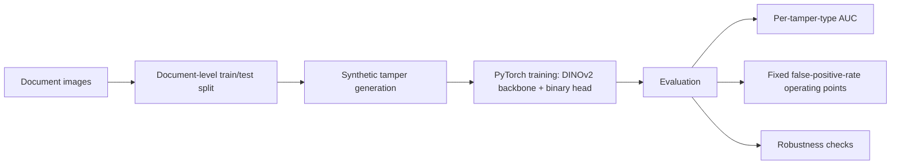

# DocForgery: Document Tamper Detection with DINOv2

A PyTorch pipeline for detecting tampered document images: it fine-tunes a DINOv2 backbone with a binary classification head and evaluates it on how well it holds up to different kinds of tampering and image degradation.

**Status:** pipeline built. No completed training run is claimed, so this write-up reports no AUC or accuracy figures.

> Source code is private. This repository is a README-only write-up. Happy to walk through the code live: [adk08644@gmail.com](mailto:adk08644@gmail.com).

## Problem

Forged documents are often edited in small regions, and detectors that look strong on one kind of edit can fail on another or after re-compression. An honest evaluation has to separate train and test by document and measure robustness per tamper type.

## Architecture

## Key engineering decisions

**Document-level split.** Train and test sets are split by document, so variants of one document never appear on both sides and inflate scores.

**Tamper generation module.** Synthetic tampering produces labelled forgeries across several tamper types, so results can be reported per type rather than as one blended number.

**Evaluation beyond a single metric.** The evaluation computes per-tamper-type AUC and detection at a fixed false-positive rate, and tests robustness to image degradation.

**Tested pipeline.** Data loading, model, training, tamper generation and evaluation are separate modules with a smoke test and tamper unit tests.

## Tech stack

Python, PyTorch, DINOv2, Jupyter.
